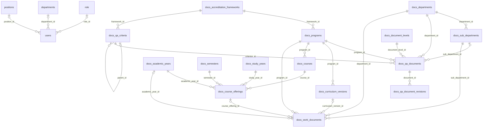

# โครงสร้างฐานข้อมูลระบบ e-SMART QA

ปรับปรุงวันที่ **22 ตุลาคม 2569 (2026-10-22)** ตาม [Prisma schema](../prisma/schema.prisma) และ [migrations](../prisma/migrations/) ใน repository ครอบคลุม **19 ตาราง และ 3 enums** เอกสารนี้อธิบายโครงสร้างตามโค้ด ไม่ใช่ผลตรวจฐานข้อมูลที่กำลังให้บริการ

การใช้งาน สิทธิ์ สถาปัตยกรรม และการติดตั้งอยู่ที่ [เอกสารระบบ](./e_smart_qa_system_documentation.md) ส่วนขั้นตอนเอกสารแยกตามงานอยู่ที่ [department-documents-setup.md](./department-documents-setup.md)

## 1. หลักการออกแบบ

- ใช้ datasource mysql ผ่าน Prisma 7 และ MariaDB adapter; URL เชื่อมต่ออ่านจาก DATABASE_URL ใน prisma.config.ts และ runtime client ใน lib/prisma.ts
- migrations สร้างตารางด้วย utf8mb4 และ utf8mb4_unicode_ci
- แยกหน่วยงานสังกัดผู้ใช้ (departments) ออกจากหน่วยงานเจ้าของเอกสาร (docs_departments) ทั้งสองชุดไม่มี Foreign Key เชื่อมกัน
- เอกสารคุณภาพที่ออกรหัสและผูกเกณฑ์เก็บใน docs_qa_documents; เอกสารตามประเภทงานและบริบทการศึกษาเก็บใน docs_work_documents
- 1 เอกสารคุณภาพผูก 1 เกณฑ์; หลักสูตรผูกกรอบเกณฑ์เดียว; เกณฑ์ใช้ parent_id สร้างต้นไม้ เช่น Area → Sub-area → Standard
- document_workflow กำหนดรูปแบบเอกสารแยกจาก code จึงเปลี่ยนรหัสงานโดยยังใช้รูปแบบเดิมได้
- ไฟล์อยู่บน filesystem; ฐานข้อมูลเก็บเส้นทางและ metadata ไม่มี BLOB

## 2. รายชื่อตาราง

| ลำดับ | ตาราง | หน้าที่ |
| --- | --- | --- |
| 1 | `users` | บัญชีผู้ใช้ |
| 2 | `departments` | หน่วยงานสังกัดของผู้ใช้ |
| 3 | `role` | บทบาทผู้ใช้ |
| 4 | `positions` | ตำแหน่งผู้ใช้ |
| 5 | `docs_departments` | หน่วยงานเจ้าของเอกสาร |
| 6 | `docs_sub_departments` | งานย่อยและรูปแบบเอกสาร |
| 7 | `docs_accreditation_frameworks` | กรอบเกณฑ์การประเมิน |
| 8 | `docs_programs` | หลักสูตร |
| 9 | `docs_document_levels` | ระดับเอกสารคุณภาพ |
| 10 | `docs_qa_criteria` | เกณฑ์ประเมินแบบลำดับชั้น |
| 11 | `docs_qa_documents` | ทะเบียนเอกสารคุณภาพ |
| 12 | `docs_qa_document_revisions` | ประวัติไฟล์เอกสารคุณภาพ |
| 13 | `docs_academic_years` | ปีการศึกษา พ.ศ. |
| 14 | `docs_semesters` | ภาคการศึกษา |
| 15 | `docs_study_years` | ชั้นปี |
| 16 | `docs_curriculum_versions` | ฉบับหลักสูตร |
| 17 | `docs_courses` | รายวิชา |
| 18 | `docs_course_offerings` | การเปิดสอนรายวิชา |
| 19 | `docs_work_documents` | เอกสารตามประเภทงาน |

## 3. ความสัมพันธ์ (ER Diagram)

เส้นแสดงความสัมพันธ์ตาม Foreign Key ส่วนกฎข้ามฟิลด์ที่ต้องตรวจใน application อยู่ในหัวข้อ 7



## 4. Data Dictionary

สัญลักษณ์: PK = Primary Key, AI = AUTO_INCREMENT, UQ = UNIQUE, FK = Foreign Key, NN = NOT NULL; NULL อนุญาตค่าว่าง; — หมายถึงไม่มี default ใน schema

ชนิดข้อมูลแสดงตาม MySQL; BOOLEAN แทนค่าจริง/เท็จ (TINYINT(1) ใน MySQL) ทุกตารางมี id เป็น PK เดี่ยว ฟิลด์ relation ของ Prisma ไม่ใช่คอลัมน์จริงจึงไม่แสดงเป็นแถว ส่วน @updatedAt เป็นพฤติกรรมของ Prisma Client ไม่ใช่ SQL trigger

### 4.1 `users` — บัญชีผู้ใช้

| คอลัมน์ | ชนิดข้อมูล | ข้อกำหนด | Default | ความหมาย |
| --- | --- | --- | --- | --- |
| `id` | INT | NN, PK, AI | AI | รหัสรายการ |
| `refId` | VARCHAR(191) | NULL, UQ | — | รหัสอ้างอิงภายนอก |
| `username` | VARCHAR(150) | NN, UQ | — | ชื่อสำหรับเข้าสู่ระบบ |
| `email` | VARCHAR(191) | NULL, UQ | — | อีเมล |
| `password_hash` | VARCHAR(255) | NULL | — | รหัสผ่านที่ผ่านการ hash |
| `email_verified_at` | DATETIME(0) | NULL | — | เวลายืนยันอีเมล |
| `password_changed_at` | DATETIME(0) | NULL | — | เวลาเปลี่ยนรหัสผ่าน |
| `last_login_at` | DATETIME(0) | NULL | — | ช่องสำหรับเวลาเข้าสู่ระบบล่าสุด |
| `must_change_password` | BOOLEAN | NN | false | ธงให้เปลี่ยนรหัสผ่าน |
| `failed_login_attempts` | INT | NN | 0 | ช่องสำหรับจำนวนครั้งที่ login ไม่สำเร็จ |
| `locked_until` | DATETIME(0) | NULL | — | ช่องสำหรับเวลาสิ้นสุดการล็อกบัญชี |
| `citizen_id` | TEXT | NULL | — | เลขประจำตัวประชาชน |
| `firstname` | TEXT | NULL | — | ชื่อ |
| `lastname` | TEXT | NULL | — | นามสกุล |
| `role_id` | INT | NULL, FK → role.id | — | บทบาท |
| `department_id` | INT | NULL, FK → departments.id | — | สังกัดผู้ใช้ ไม่ใช่ docs_departments |
| `position_id` | INT | NULL, FK → positions.id | — | ตำแหน่ง |
| `is_active` | BOOLEAN | NN | true | สถานะเปิดใช้งาน |
| `created_at` | DATETIME(0) | NN | — | เวลาสร้าง |
| `updated_at` | DATETIME(0) | NN | — | เวลาแก้ไขล่าสุด |

### 4.2 `departments` — หน่วยงานสังกัดของผู้ใช้

| คอลัมน์ | ชนิดข้อมูล | ข้อกำหนด | Default | ความหมาย |
| --- | --- | --- | --- | --- |
| `id` | INT | NN, PK, AI | AI | รหัสรายการ |
| `name` | TEXT | NN | — | ชื่อรายการ |
| `is_active` | BOOLEAN | NN | true | สถานะเปิดใช้งาน |
| `created_at` | DATETIME(0) | NN | — | เวลาสร้าง |
| `updated_at` | DATETIME(0) | NN | — | เวลาแก้ไขล่าสุด |

### 4.3 `role` — บทบาทผู้ใช้

| คอลัมน์ | ชนิดข้อมูล | ข้อกำหนด | Default | ความหมาย |
| --- | --- | --- | --- | --- |
| `id` | INT | NN, PK, AI | AI | รหัสรายการ |
| `name` | TEXT | NN | — | ชื่อบทบาท เช่น admin, staff, user; ไม่มี UNIQUE |
| `is_active` | BOOLEAN | NN | true | สถานะเปิดใช้งาน |
| `created_at` | DATETIME(0) | NN | — | เวลาสร้าง |
| `updated_at` | DATETIME(0) | NN | — | เวลาแก้ไขล่าสุด |

### 4.4 `positions` — ตำแหน่งผู้ใช้

| คอลัมน์ | ชนิดข้อมูล | ข้อกำหนด | Default | ความหมาย |
| --- | --- | --- | --- | --- |
| `id` | INT | NN, PK, AI | AI | รหัสรายการ |
| `name` | TEXT | NN | — | ชื่อรายการ |
| `is_active` | BOOLEAN | NN | true | สถานะเปิดใช้งาน |
| `created_at` | DATETIME(0) | NN | — | เวลาสร้าง |
| `updated_at` | DATETIME(0) | NN | — | เวลาแก้ไขล่าสุด |

### 4.5 `docs_departments` — หน่วยงานเจ้าของเอกสาร

| คอลัมน์ | ชนิดข้อมูล | ข้อกำหนด | Default | ความหมาย |
| --- | --- | --- | --- | --- |
| `id` | INT UNSIGNED | NN, PK, AI | AI | รหัสรายการ |
| `code` | VARCHAR(20) | NN, UQ | — | รหัสอ้างอิงทางธุรกิจ |
| `name_th` | VARCHAR(150) | NN | — | ชื่อภาษาไทย |
| `name_en` | VARCHAR(150) | NULL | — | ชื่อภาษาอังกฤษ |
| `has_sub_department` | BOOLEAN | NN | false | มีงานย่อยหรือไม่ |
| `sort_order` | INT UNSIGNED | NN | 0 | ลำดับแสดงผล |
| `is_active` | BOOLEAN | NN | true | สถานะเปิดใช้งาน |
| `created_at` | TIMESTAMP(0) | NN | now() | เวลาสร้าง |
| `updated_at` | TIMESTAMP(0) | NN, @updatedAt | now() | เวลาแก้ไขล่าสุด |

### 4.6 `docs_sub_departments` — งานย่อยและรูปแบบเอกสาร

| คอลัมน์ | ชนิดข้อมูล | ข้อกำหนด | Default | ความหมาย |
| --- | --- | --- | --- | --- |
| `document_workflow` | ENUM('QA','CM','TCH','ASM','ADM') | NULL | — | รูปแบบเอกสารของงาน; NULL ใช้เอกสารคุณภาพทั่วไป |
| `id` | INT UNSIGNED | NN, PK, AI | AI | รหัสรายการ |
| `department_id` | INT UNSIGNED | NN, FK → docs_departments.id | — | หน่วยงาน |
| `code` | VARCHAR(20) | NN | — | รหัสงาน แก้ไขแยกจาก document_workflow ได้ |
| `name_th` | VARCHAR(150) | NN | — | ชื่อภาษาไทย |
| `name_en` | VARCHAR(150) | NULL | — | ชื่อภาษาอังกฤษ |
| `sort_order` | INT UNSIGNED | NN | 0 | ลำดับแสดงผล |
| `is_active` | BOOLEAN | NN | true | สถานะเปิดใช้งาน |
| `created_at` | TIMESTAMP(0) | NN | now() | เวลาสร้าง |
| `updated_at` | TIMESTAMP(0) | NN, @updatedAt | now() | เวลาแก้ไขล่าสุด |

### 4.7 `docs_accreditation_frameworks` — กรอบเกณฑ์การประเมิน

| คอลัมน์ | ชนิดข้อมูล | ข้อกำหนด | Default | ความหมาย |
| --- | --- | --- | --- | --- |
| `id` | INT UNSIGNED | NN, PK, AI | AI | รหัสรายการ |
| `code` | VARCHAR(20) | NN, UQ | — | รหัสอ้างอิงทางธุรกิจ |
| `prefix_char` | VARCHAR(5) | NN | — | คำนำหน้ารหัสเกณฑ์ เช่น W, A |
| `name_th` | VARCHAR(150) | NN | — | ชื่อภาษาไทย |
| `name_en` | VARCHAR(150) | NULL | — | ชื่อภาษาอังกฤษ |
| `version_year` | VARCHAR(20) | NULL | — | รุ่นหรือปีของกรอบเกณฑ์ |
| `is_active` | BOOLEAN | NN | true | สถานะเปิดใช้งาน |
| `created_at` | TIMESTAMP(0) | NN | now() | เวลาสร้าง |
| `updated_at` | TIMESTAMP(0) | NN, @updatedAt | now() | เวลาแก้ไขล่าสุด |

### 4.8 `docs_programs` — หลักสูตร

| คอลัมน์ | ชนิดข้อมูล | ข้อกำหนด | Default | ความหมาย |
| --- | --- | --- | --- | --- |
| `id` | INT UNSIGNED | NN, PK, AI | AI | รหัสรายการ |
| `code` | VARCHAR(20) | NN, UQ | — | รหัสอ้างอิงทางธุรกิจ |
| `name_th` | VARCHAR(200) | NN | — | ชื่อภาษาไทย |
| `name_en` | VARCHAR(200) | NULL | — | ชื่อภาษาอังกฤษ |
| `framework_id` | INT UNSIGNED | NN, FK → docs_accreditation_frameworks.id | — | กรอบเกณฑ์การประเมิน |
| `is_active` | BOOLEAN | NN | true | สถานะเปิดใช้งาน |
| `created_at` | TIMESTAMP(0) | NN | now() | เวลาสร้าง |
| `updated_at` | TIMESTAMP(0) | NN, @updatedAt | now() | เวลาแก้ไขล่าสุด |

### 4.9 `docs_document_levels` — ระดับเอกสารคุณภาพ

| คอลัมน์ | ชนิดข้อมูล | ข้อกำหนด | Default | ความหมาย |
| --- | --- | --- | --- | --- |
| `id` | INT UNSIGNED | NN, PK, AI | AI | รหัสรายการ |
| `code` | VARCHAR(10) | NN, UQ | — | รหัสอ้างอิงทางธุรกิจ |
| `name_th` | VARCHAR(100) | NN | — | ชื่อภาษาไทย |
| `name_en` | VARCHAR(100) | NULL | — | ชื่อภาษาอังกฤษ |
| `level_order` | INT UNSIGNED | NN | 1 | ลำดับระดับเอกสาร |
| `is_active` | BOOLEAN | NN | true | สถานะเปิดใช้งาน |
| `created_at` | TIMESTAMP(0) | NN | now() | เวลาสร้าง |
| `updated_at` | TIMESTAMP(0) | NN, @updatedAt | now() | เวลาแก้ไขล่าสุด |

### 4.10 `docs_qa_criteria` — เกณฑ์ประเมินแบบลำดับชั้น

| คอลัมน์ | ชนิดข้อมูล | ข้อกำหนด | Default | ความหมาย |
| --- | --- | --- | --- | --- |
| `id` | INT UNSIGNED | NN, PK, AI | AI | รหัสรายการ |
| `framework_id` | INT UNSIGNED | NN, FK → docs_accreditation_frameworks.id | — | กรอบเกณฑ์การประเมิน |
| `parent_id` | INT UNSIGNED | NULL, FK → docs_qa_criteria.id | — | เกณฑ์แม่; NULL คือรากของต้นไม้ |
| `code` | VARCHAR(30) | NN | — | รหัสอ้างอิงทางธุรกิจ |
| `section_number` | VARCHAR(20) | NN | — | เลขข้อที่แสดง |
| `level_depth` | INT UNSIGNED | NN | 1 | ระดับในต้นไม้เกณฑ์ |
| `wfme_standard_type` | ENUM('NONE','BASIC','QUALITY_DEV') | NN | NONE | ประเภทมาตรฐาน WFME |
| `title_th` | VARCHAR(500) | NN | — | ชื่อเกณฑ์ภาษาไทย |
| `title_en` | VARCHAR(500) | NULL | — | ชื่อเกณฑ์ภาษาอังกฤษ |
| `description_th` | TEXT | NULL | — | รายละเอียดเกณฑ์ภาษาไทย |
| `is_selectable` | BOOLEAN | NN | true | อนุญาตให้เลือกผูกเอกสาร |
| `sort_order` | INT UNSIGNED | NN | 0 | ลำดับแสดงผล |
| `is_active` | BOOLEAN | NN | true | สถานะเปิดใช้งาน |
| `created_at` | TIMESTAMP(0) | NN | now() | เวลาสร้าง |
| `updated_at` | TIMESTAMP(0) | NN, @updatedAt | now() | เวลาแก้ไขล่าสุด |

### 4.11 `docs_qa_documents` — ทะเบียนเอกสารคุณภาพ

| คอลัมน์ | ชนิดข้อมูล | ข้อกำหนด | Default | ความหมาย |
| --- | --- | --- | --- | --- |
| `id` | BIGINT UNSIGNED | NN, PK, AI | AI | รหัสรายการ |
| `document_code` | VARCHAR(100) | NN, UQ | — | รหัสเอกสารเต็มที่ไม่ซ้ำ |
| `sequence_no` | VARCHAR(10) | NULL | "000" | ลำดับเอกสาร เก็บเป็นข้อความ |
| `title` | VARCHAR(500) | NN | — | ชื่อเรื่อง |
| `description` | TEXT | NULL | — | คำอธิบาย |
| `department_id` | INT UNSIGNED | NN, FK → docs_departments.id | — | หน่วยงาน |
| `sub_department_id` | INT UNSIGNED | NULL, FK → docs_sub_departments.id | — | งานย่อย |
| `program_id` | INT UNSIGNED | NN, FK → docs_programs.id | — | หลักสูตร |
| `document_level_id` | INT UNSIGNED | NN, FK → docs_document_levels.id | — | ระดับเอกสารคุณภาพ |
| `criterion_id` | INT UNSIGNED | NN, FK → docs_qa_criteria.id | — | เกณฑ์ที่เอกสารอ้างอิง |
| `current_version` | VARCHAR(20) | NN | "1.0" | เวอร์ชันปัจจุบัน |
| `effective_date` | DATE | NULL | — | วันที่เริ่มใช้ |
| `review_date` | DATE | NULL | — | วันที่ทบทวน |
| `file_path` | VARCHAR(1000) | NULL | — | เส้นทางไฟล์ |
| `file_name` | VARCHAR(255) | NULL | — | ชื่อไฟล์เดิม |
| `file_mime_type` | VARCHAR(100) | NULL | — | MIME type |
| `file_size_bytes` | BIGINT UNSIGNED | NULL | — | ขนาดไฟล์เป็นไบต์ |
| `status` | ENUM('DRAFT','PUBLISHED','ARCHIVED') | NN | DRAFT | สถานะเอกสาร |
| `created_by` | VARCHAR(100) | NULL | — | รหัสผู้เพิ่มในรูปข้อความ ไม่มี FK |
| `updated_by` | VARCHAR(100) | NULL | — | รหัสผู้แก้ไขในรูปข้อความ ไม่มี FK |
| `created_at` | TIMESTAMP(0) | NN | now() | เวลาสร้าง |
| `updated_at` | TIMESTAMP(0) | NN, @updatedAt | now() | เวลาแก้ไขล่าสุด |

### 4.12 `docs_qa_document_revisions` — ประวัติไฟล์เอกสารคุณภาพ

| คอลัมน์ | ชนิดข้อมูล | ข้อกำหนด | Default | ความหมาย |
| --- | --- | --- | --- | --- |
| `id` | BIGINT UNSIGNED | NN, PK, AI | AI | รหัสรายการ |
| `document_id` | BIGINT UNSIGNED | NN, FK → docs_qa_documents.id | — | เอกสารต้นทาง |
| `version_label` | VARCHAR(20) | NN | — | ชื่อเวอร์ชัน |
| `change_note` | TEXT | NULL | — | บันทึกการเปลี่ยนแปลง |
| `file_path` | VARCHAR(1000) | NN | — | เส้นทางไฟล์ |
| `file_name` | VARCHAR(255) | NN | — | ชื่อไฟล์เดิม |
| `file_mime_type` | VARCHAR(100) | NULL | — | MIME type |
| `file_size_bytes` | BIGINT UNSIGNED | NULL | — | ขนาดไฟล์เป็นไบต์ |
| `uploaded_by` | VARCHAR(100) | NULL | — | รหัสผู้อัปโหลดในรูปข้อความ ไม่มี FK |
| `created_at` | TIMESTAMP(0) | NN | now() | เวลาสร้าง |

### 4.13 `docs_academic_years` — ปีการศึกษา พ.ศ.

| คอลัมน์ | ชนิดข้อมูล | ข้อกำหนด | Default | ความหมาย |
| --- | --- | --- | --- | --- |
| `id` | INT UNSIGNED | NN, PK, AI | AI | รหัสรายการ |
| `year` | SMALLINT UNSIGNED | NN, UQ | — | ปีการศึกษา พ.ศ. เช่น 2569 |
| `is_active` | BOOLEAN | NN | true | สถานะเปิดใช้งาน |

### 4.14 `docs_semesters` — ภาคการศึกษา

| คอลัมน์ | ชนิดข้อมูล | ข้อกำหนด | Default | ความหมาย |
| --- | --- | --- | --- | --- |
| `id` | INT UNSIGNED | NN, PK, AI | AI | รหัสรายการ |
| `code` | VARCHAR(20) | NN, UQ | — | รหัสอ้างอิงทางธุรกิจ |
| `name_th` | VARCHAR(100) | NN | — | ชื่อภาษาไทย |
| `sort_order` | INT UNSIGNED | NN | 0 | ลำดับแสดงผล |
| `is_active` | BOOLEAN | NN | true | สถานะเปิดใช้งาน |

### 4.15 `docs_study_years` — ชั้นปี

| คอลัมน์ | ชนิดข้อมูล | ข้อกำหนด | Default | ความหมาย |
| --- | --- | --- | --- | --- |
| `id` | INT UNSIGNED | NN, PK, AI | AI | รหัสรายการ |
| `year` | TINYINT UNSIGNED | NN, UQ | — | ชั้นปี เช่น 1–6 ใน seed |
| `is_active` | BOOLEAN | NN | true | สถานะเปิดใช้งาน |

### 4.16 `docs_curriculum_versions` — ฉบับหลักสูตร

| คอลัมน์ | ชนิดข้อมูล | ข้อกำหนด | Default | ความหมาย |
| --- | --- | --- | --- | --- |
| `id` | INT UNSIGNED | NN, PK, AI | AI | รหัสรายการ |
| `program_id` | INT UNSIGNED | NN, FK → docs_programs.id | — | หลักสูตร |
| `year` | SMALLINT UNSIGNED | NN | — | ปีฉบับหลักสูตร พ.ศ. |
| `is_initial` | BOOLEAN | NN | false | true = หลักสูตรใหม่; false = ฉบับปรับปรุง |
| `is_active` | BOOLEAN | NN | true | สถานะเปิดใช้งาน |

### 4.17 `docs_courses` — รายวิชา

| คอลัมน์ | ชนิดข้อมูล | ข้อกำหนด | Default | ความหมาย |
| --- | --- | --- | --- | --- |
| `id` | INT UNSIGNED | NN, PK, AI | AI | รหัสรายการ |
| `program_id` | INT UNSIGNED | NN, FK → docs_programs.id | — | หลักสูตร |
| `code` | VARCHAR(30) | NN | — | รหัสอ้างอิงทางธุรกิจ |
| `name_th` | VARCHAR(200) | NN | — | ชื่อภาษาไทย |
| `is_active` | BOOLEAN | NN | true | สถานะเปิดใช้งาน |

### 4.18 `docs_course_offerings` — การเปิดสอนรายวิชา

| คอลัมน์ | ชนิดข้อมูล | ข้อกำหนด | Default | ความหมาย |
| --- | --- | --- | --- | --- |
| `id` | INT UNSIGNED | NN, PK, AI | AI | รหัสรายการ |
| `course_id` | INT UNSIGNED | NN, FK → docs_courses.id | — | รายวิชา |
| `academic_year_id` | INT UNSIGNED | NN, FK → docs_academic_years.id | — | ปีการศึกษา |
| `semester_id` | INT UNSIGNED | NN, FK → docs_semesters.id | — | ภาคเรียน |
| `study_year_id` | INT UNSIGNED | NN, FK → docs_study_years.id | — | ชั้นปี |
| `is_active` | BOOLEAN | NN | true | สถานะเปิดใช้งาน |

### 4.19 `docs_work_documents` — เอกสารตามประเภทงาน

| คอลัมน์ | ชนิดข้อมูล | ข้อกำหนด | Default | ความหมาย |
| --- | --- | --- | --- | --- |
| `id` | BIGINT UNSIGNED | NN, PK, AI | AI | รหัสรายการ |
| `department_id` | INT UNSIGNED | NN, FK → docs_departments.id | — | หน่วยงาน |
| `sub_department_id` | INT UNSIGNED | NN, FK → docs_sub_departments.id | — | งานย่อย |
| `program_id` | INT UNSIGNED | NN, FK → docs_programs.id | — | หลักสูตร |
| `academic_year_id` | INT UNSIGNED | NULL, FK → docs_academic_years.id | — | ปีการศึกษา |
| `curriculum_version_id` | INT UNSIGNED | NULL, FK → docs_curriculum_versions.id | — | ฉบับหลักสูตร |
| `course_offering_id` | INT UNSIGNED | NULL, FK → docs_course_offerings.id | — | การเปิดสอน |
| `document_type` | VARCHAR(30) | NN | — | ประเภทเอกสารตาม workflow เป็น VARCHAR ไม่ใช่ enum |
| `title` | VARCHAR(500) | NN | — | ชื่อเรื่อง |
| `file_path` | VARCHAR(1000) | NN | — | เส้นทางไฟล์ |
| `file_name` | VARCHAR(255) | NN | — | ชื่อไฟล์เดิม |
| `file_size_bytes` | BIGINT UNSIGNED | NN | — | ขนาดไฟล์เป็นไบต์ |
| `created_by` | VARCHAR(100) | NN | — | รหัสผู้เพิ่มในรูปข้อความ ใช้ตรวจสิทธิ์ลบ ไม่มี FK |
| `created_at` | TIMESTAMP(0) | NN | now() | เวลาสร้าง |

### 4.20 ข้อสังเกตของคอลัมน์

- users และ lookup ของผู้ใช้ใช้ DATETIME(0) ไม่มี default และไม่มี @updatedAt ผู้เรียกต้องกำหนดวันเวลาตามการทำงานของแต่ละฟังก์ชัน
- updated_at ของตารางเอกสารที่มี @updatedAt ถูกจัดการโดย Prisma; migration ให้ default CURRENT_TIMESTAMP(0) แต่ไม่ได้สร้าง ON UPDATE CURRENT_TIMESTAMP การแก้ SQL โดยตรงต้องระบุเวลาแก้ไขเอง
- ตารางปี/ภาค/ชั้นปี/ฉบับหลักสูตร/รายวิชา/การเปิดสอนไม่มี created_at และ updated_at
- BIGINT ของรหัสและขนาดไฟล์ถูกแปลงเป็น string ก่อนส่งให้ client เพื่อให้ serialize ได้
- docs_qa_document_revisions มีใน schema และ migration แล้ว แต่ขั้นตอนบันทึกปัจจุบันยังไม่เพิ่ม revision และไม่มี UNIQUE บน (document_id, version_label)
- docs_work_documents ไม่มี document_code, criterion_id, status, current_version, file_mime_type หรือ updated_at และไม่มี UNIQUE จำกัดจำนวนไฟล์ต่อประเภทในบริบทเดียวกัน

## 5. Enums

| Prisma enum | ค่าที่อนุญาต | คอลัมน์ |
| --- | --- | --- |
| docs_qa_document_status | DRAFT, PUBLISHED, ARCHIVED | docs_qa_documents.status |
| docs_wfme_standard_type | NONE, BASIC, QUALITY_DEV | docs_qa_criteria.wfme_standard_type |
| docs_document_workflow | QA, CM, TCH, ASM, ADM | docs_sub_departments.document_workflow (NULL ได้) |

Enums ใช้เป็นชนิด ENUM ของคอลัมน์ MySQL ไม่ใช่ตารางแยก ส่วน role.name และ docs_work_documents.document_type เป็นข้อความ ไม่ใช่ enum ของฐานข้อมูล

## 6. Constraints และ indexes

### 6.1 UNIQUE และ indexes ที่ประกาศใน Prisma schema

ทุกตารางมี PRIMARY KEY (id) เพิ่มจากรายการต่อไปนี้ ตารางที่ไม่ปรากฏไม่มี UNIQUE หรือ @@index เพิ่มเติมใน schema

| ตาราง | UNIQUE | Index เพิ่มเติม (@@index) |
| --- | --- | --- |
| `users` | refId; username; email | — |
| `docs_departments` | code | — |
| `docs_sub_departments` | (department_id, code) | — |
| `docs_accreditation_frameworks` | code | — |
| `docs_programs` | code | (framework_id) |
| `docs_document_levels` | code | — |
| `docs_qa_criteria` | (framework_id, code) | (parent_id); (framework_id, level_depth, sort_order) |
| `docs_qa_documents` | document_code | (department_id, sub_department_id); (program_id); (document_level_id); (criterion_id); (status) |
| `docs_qa_document_revisions` | — | (document_id) |
| `docs_academic_years` | year | — |
| `docs_semesters` | code | — |
| `docs_study_years` | year | — |
| `docs_curriculum_versions` | (program_id, year) | — |
| `docs_courses` | (program_id, code) | — |
| `docs_course_offerings` | (course_id, academic_year_id, semester_id, study_year_id) | (academic_year_id, semester_id, study_year_id) |
| `docs_work_documents` | — | (department_id, sub_department_id, program_id, academic_year_id); (curriculum_version_id); (course_offering_id) |

MySQL อาจสร้าง index เพิ่มเพื่อรองรับ Foreign Key แม้ไม่ได้ประกาศ @@index รายการนี้จึงไม่ใช่ผล SHOW INDEX จากฐานข้อมูลจริง UNIQUE ของ nullable column เช่น email อนุญาตหลายแถวที่เป็น NULL

### 6.2 Foreign Key actions

คอลัมน์ FK และปลายทางแสดงครบใน Data Dictionary โดย actions มีดังนี้:

| กลุ่มความสัมพันธ์ | ON DELETE | ON UPDATE |
| --- | --- | --- |
| users → role, departments, positions | SET NULL | CASCADE |
| docs_qa_document_revisions → docs_qa_documents | CASCADE | CASCADE |
| Foreign Key อื่นทั้งหมดในกลุ่ม docs_* | RESTRICT | CASCADE |

ระดับ application ปฏิเสธการลบสังกัด/ตำแหน่งที่มีผู้ใช้อ้างอิง แม้ DB รองรับ SET NULL การลบแถวด้วย SQL ไม่ลบไฟล์บน filesystem และ CASCADE ของ revisions มีผลเฉพาะแถวข้อมูล

## 7. กฎข้อมูลที่ตรวจใน application

### 7.1 เอกสารคุณภาพและการประกอบรหัส

ตรวจใน lib/quality-document-save.ts:

1. หน่วยงาน หลักสูตร ระดับเอกสาร และเกณฑ์ต้องเปิดใช้งาน
2. หน่วยงานที่มีงานย่อยต้องระบุงานที่อยู่ภายใต้หน่วยงานนั้น; หน่วยงานที่ไม่มีงานย่อยต้องไม่ส่งงานย่อย
3. ค้นเกณฑ์ด้วย (program.framework_id, criterion.code) และต้องมี is_selectable = true ค่านี้เป็นตัวกำหนดสิทธิ์เลือก ไม่ใช่ DB constraint ว่าต้องเป็น leaf node
4. ลำดับจากฟอร์มเป็นเลข 0–999 เติมศูนย์ให้ครบ 3 หลัก ผู้ใช้กำหนดเอง ยังไม่มีการรันเลขอัตโนมัติ แม้ sequence_no รองรับ VARCHAR(10) และ NULL
5. สร้างรายการเป็น DRAFT เวอร์ชัน 1.0 แนบไฟล์หรือไม่ก็ได้ รหัสซ้ำถูกปฏิเสธด้วย UNIQUE

```text
มีงานย่อย:  <หน่วยงาน>-<งานย่อย>-<หลักสูตร>-<ระดับเอกสาร>-<เกณฑ์>-<ลำดับ>
ไม่มีงานย่อย: <หน่วยงาน>-<หลักสูตร>-<ระดับเอกสาร>-<เกณฑ์>-<ลำดับ>

EDU-ADM-M.D.-QM-W1.1.1-000
EDU-ADM-B.PMD.-QM-A1.1-1-000
MGT-M.D.-QM-W1.1.1-000
```

ตัวอย่างรหัสไม่ได้ยืนยันว่ามีรายการเหล่านี้ในฐานข้อมูล ตัว formatter ใช้ criterion.code โดยตรง ไม่เติม prefix_char ซ้ำ

### 7.2 เอกสารตามประเภทงาน

ตรวจใน lib/work-documents.ts และกำหนดประเภทใน lib/department-workflow.ts:

| Workflow / กรอบเกณฑ์ | โหมด | academic_year_id | curriculum_version_id | course_offering_id | document_type ที่ระบบรับ |
| --- | --- | --- | --- | --- | --- |
| QA / WFME | year | ต้องมี | NULL | NULL | SAR, ACCREDITATION, APR, APR_RESULT |
| QA / AUN | year | ต้องมี | NULL | NULL | SAR, CAR |
| CM | version | NULL | ต้องมี | NULL | CURRICULUM |
| TCH | course | ต้องมี | NULL | ต้องมี | TQF3, TQF5, EVALUATION |
| ASM | course | ต้องมี | NULL | ต้องมี | STUDY_RESULT |
| ADM | year | ต้องมี | NULL | NULL | ADMISSION_ANNOUNCEMENT |

- หน่วยงาน งานย่อย หลักสูตร กรอบเกณฑ์ และข้อมูลบริบทที่ใช้ต้องเปิดใช้งาน หน่วยงานต้องรองรับงานย่อย
- ฉบับหลักสูตรต้องอยู่ใต้หลักสูตรที่เลือก การเปิดสอนต้องตรงหลักสูตรและปีการศึกษา รวมทั้งรายวิชา ภาคเรียน และชั้นปีต้องเปิดใช้งาน
- QA รองรับประเภทไฟล์ตามรหัสกรอบเกณฑ์ WFME หรือ AUN เท่านั้น
- ต้องแนบไฟล์ และใช้ user ID จาก session เป็น created_by
- บล็อกการเปลี่ยนหน่วยงานหรือ workflow ของงานย่อยที่มีเอกสารงานแล้ว และบล็อกการย้ายฉบับหลักสูตร/รายวิชา/การเปิดสอนที่มีเอกสารอ้างอิงตามเงื่อนไขใน lib/master-data.ts และ lib/academic-data.ts

FK ของแต่ละคอลัมน์ไม่ได้บังคับว่าโปรแกรมกับเกณฑ์ใช้กรอบเดียวกัน งานย่อยอยู่ใต้หน่วยงานที่ระบุ หรือปี/หลักสูตรตรงกับการเปิดสอน และไม่มี CHECK constraint สำหรับชุด NULL ตาม workflow การเขียน SQL โดยตรงต้องรักษากฎเหล่านี้เอง

### 7.3 ผู้ใช้และสิทธิ์ที่เกี่ยวกับข้อมูล

created_by, updated_by, uploaded_by เป็น VARCHAR ไม่มี FK ไป users ค่า user ID ที่บันทึกเป็นข้อความ ผู้เพิ่มเอกสารงานหรือ admin มีสิทธิ์ลบเอกสารงาน สังกัดผู้ใช้ไม่ได้จำกัดการอ่าน/เพิ่มให้เฉพาะเอกสารของหน่วยงานตนเอง

ปัจจุบัน login ตรวจ username, is_active, password_hash และโหลดบทบาท ส่วน last_login_at, failed_login_attempts, locked_until, email_verified_at ยังไม่มีขั้นตอนใช้งานใน lib/auth.ts ขณะที่ must_change_password ถูกตั้งค่าจากการจัดการผู้ใช้ แต่ยังไม่มี flow บังคับเปลี่ยนรหัสผ่าน

สถานะ PUBLISHED/ARCHIVED และข้อมูล revision มี schema รองรับ แต่ยังไม่มีขั้นตอนอนุมัติ เผยแพร่ จัดเก็บ หรือจัดการประวัติเวอร์ชันผ่านหน้าจอปัจจุบัน

## 8. ประวัติ migration

ใช้ migration files เป็นแหล่ง SQL สำหรับสร้าง/เปลี่ยนโครงสร้าง ไม่ควรนำ SQL ตัวอย่างจากเอกสารออกแบบเก่ามาสร้างตารางซ้ำ

| Migration | การเปลี่ยนแปลง |
| --- | --- |
| 20261012073644_init | สร้าง users, department, role, position และ FK ของผู้ใช้ |
| 20261020142102_rename_core_tables | เปลี่ยน department → departments และ position → positions |
| 20261020142159_add_docs_master_tables | สร้าง 8 ตารางเอกสารคุณภาพ ตั้งแต่ docs_departments ถึง docs_qa_document_revisions |
| 20261021000000_rename_is_active | เปลี่ยน isActive → is_active ใน 4 ตารางผู้ใช้ |
| 20261021010000_remove_unused_employee_id | ลบ employee_id ออกจาก departments, positions, role |
| 20261021020000_add_department_work_documents | เพิ่ม 7 ตารางข้อมูลการศึกษาและเอกสารตามงาน |
| 20261021030000_add_document_workflow | เพิ่ม document_workflow และตั้งค่าให้ข้อมูลงานเดิมตาม code/name |
| 20261021040000_add_unique_usernames | เปลี่ยน username เป็น VARCHAR(150) และเพิ่ม UNIQUE |

ตรวจสถานะและ deploy migrations จาก project root หลังตั้ง DATABASE_URL:

```powershell
node node_modules/prisma/build/index.js migrate status
node node_modules/prisma/build/index.js migrate deploy
node node_modules/prisma/build/index.js generate
```

Deploy เปลี่ยนฐานข้อมูลตาม migration ที่ยังไม่ถูกใช้ ส่วน generate สร้าง client ตาม schema โดยไม่เปลี่ยนฐานข้อมูล การอัปเดตเอกสารครั้งนี้ไม่ได้รัน migration หรือ seed

## 9. ข้อมูลเริ่มต้น

- prisma/seed.ts: บทบาท บัญชีทดสอบ หน่วยงาน EDU/MGT งานย่อย กรอบ WFME/AUN หลักสูตร M.D./B.PMD. ระดับ QM/SP/WI/FM/SD และเกณฑ์ตัวอย่าง จากนั้นเรียก seed ข้อมูลการศึกษา
- prisma/seed-department-documents.mjs เรียก seed-department-data.mjs: เพิ่มปี 2569 ภาคเรียน 1/2/SUMMER ชั้นปี 1–6 งาน QA/CM และฉบับหลักสูตรที่ยังขาด โดย upsert ใช้ update ว่าง ไม่เพิ่มรายวิชาหรือไฟล์สมมติ
- ฉบับหลักสูตรเริ่มต้น: M.D. ปี 2553/2565/2570; B.PMD. ปี 2553/2559/2564/2569 โดยปี 2553 ตั้ง is_initial = true

Seed ทั้งระบบอัปเดตบัญชีทดสอบและรหัสผ่านเดิม จึงควรใช้เฉพาะฐานข้อมูลสำหรับพัฒนา การเพิ่มข้อมูลการศึกษาให้ระบบเดิมดู [department-documents-setup.md](./department-documents-setup.md) เกณฑ์ใน seed เป็นตัวอย่าง ไม่ใช่ชุดเกณฑ์ฉบับสมบูรณ์
