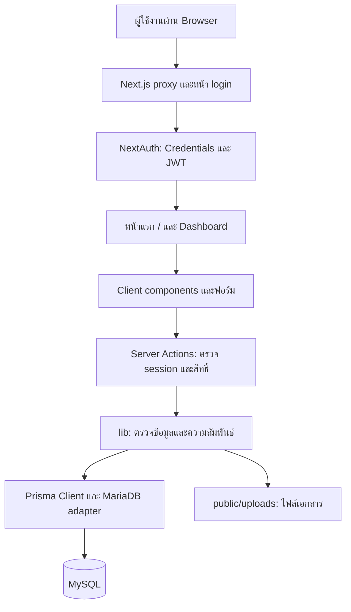

# เอกสารระบบ e-SMART QA

ปรับปรุงวันที่ **24 ตุลาคม 2569 (2026-10-24)** อ้างอิงโค้ดและ configuration ใน repository สำหรับผู้ใช้งาน ผู้ดูแลระบบ และผู้พัฒนาที่ดูแลระบบต่อ

รายละเอียดตาราง คอลัมน์ ความสัมพันธ์ และ migrations อยู่ที่ [โครงสร้างฐานข้อมูล](./e_smart_qa_database_schema.md) ส่วนขั้นตอนเฉพาะของเอกสารแยกตามประเภทงานอยู่ที่ [department-documents-setup.md](./department-documents-setup.md)

## 1. วัตถุประสงค์และขอบเขต

e-SMART QA เป็นระบบบริหารเอกสารคุณภาพการศึกษาของคณะแพทยศาสตร์ มหาวิทยาลัยพะเยา รองรับการจัดทะเบียนเอกสารตามหน่วยงาน หลักสูตร ระดับเอกสาร และเกณฑ์ประเมิน รวมถึงจัดเก็บเอกสารตามบริบทปีการศึกษา ฉบับหลักสูตร และการเปิดสอนรายวิชา

เอกสารมีสองชุดที่จัดเก็บแยกกัน:

| ชุดเอกสาร | ลักษณะ | ที่เก็บข้อมูล |
| --- | --- | --- |
| เอกสารคุณภาพ | มีรหัสเอกสาร ผูกเกณฑ์หนึ่งข้อ ระบุระดับ QM/SP/WI/FM/SD แนบไฟล์หรือไม่ก็ได้ | `docs_qa_documents` |
| เอกสารตามประเภทงาน | แยกงาน QA/CM/TCH/ASM/ADM ต้องแนบไฟล์ เลือกบริบทตามประเภทงาน | `docs_work_documents` |

หน้าเอกสารคุณภาพทั้งหมดแสดงชุดแรก ส่วนเอกสารตามประเภทงานดูผ่านหน้าแยกตามหน่วยงาน เมื่อไม่มี workflow จะใช้รายการเอกสารคุณภาพที่กรองตามหน่วยงาน งานย่อย และหลักสูตร

## 2. เทคโนโลยีและสถาปัตยกรรม

| ส่วนประกอบ | เทคโนโลยีตาม package.json |
| --- | --- |
| Web framework | Next.js 16.4.0, App Router |
| UI | React/React DOM 19.3.0, Ant Design ^6.6.6, Tailwind CSS ^4, Lucide icons |
| ภาษา | TypeScript ^5 |
| Authentication | NextAuth ^4.24.15, Credentials provider, JWT session |
| รหัสผ่าน | bcrypt ^6.0.0 |
| Database access | Prisma / Prisma Client / MariaDB adapter ^7.10.0, datasource mysql |
| ที่เก็บไฟล์ | filesystem ภายใต้ `storage/qa-documents` และ `public/uploads` |



หน้าแรกโหลด session และข้อมูลหลักบน server ก่อนส่งข้อมูลสำหรับแสดงผลไปยัง Dashboard การเพิ่ม/อ่าน/ลบข้อมูลใช้ Server Actions; ไม่ได้มี REST API สำหรับเอกสารแยกชุด ส่วน API route ที่มีคือ NextAuth

`next.config.ts` เปิด `cacheComponents`, `partialPrefetching`, `experimental.agentFeedback` และกำหนด Server Actions body limit เป็น `25mb` ขณะที่ฟังก์ชันอัปโหลดจำกัดไฟล์แต่ละไฟล์ที่ 20 × 1024 × 1024 ไบต์

## 3. ผู้ใช้งานและสิทธิ์

| ความสามารถ | admin | staff / user |
| --- | --- | --- |
| เข้าระบบ ดูรายการ และเปิดไฟล์เอกสารจากหน้าจอ | ได้ | ได้ |
| เพิ่มเอกสารคุณภาพและเอกสารตามประเภทงาน | ได้ | ได้ |
| แก้ร่าง/ส่งตรวจเอกสารคุณภาพ | ทุกรายการ | เฉพาะทะเบียนที่ตนเป็นผู้เพิ่ม |
| ตรวจสอบอนุมัติ/ส่งกลับแก้ไข | ได้ เมื่อไม่ได้เป็นผู้จัดทำหรือส่งตรวจฉบับนั้น | ไม่ได้ |
| ลบเอกสารคุณภาพออกจากรายการใช้งาน | ได้ โดยระบุเหตุผลและยืนยันรหัส | ไม่ได้ |
| ดู Audit log รวมทั้งระบบ | ได้ | ไม่ได้ |
| ลบเอกสารตามประเภทงาน | ทุกรายการ | เฉพาะรายการที่ตนเป็นผู้เพิ่ม |
| จัดการข้อมูลพื้นฐานเอกสารและการศึกษา | ได้ | ไม่ได้ |
| จัดการผู้ใช้ สังกัด และตำแหน่ง | ได้ | ไม่ได้ |
| ดูข้อมูลบัญชีของตน | ได้ | ได้ |

เมนู admin แสดงตามชื่อบทบาท `admin` ใน session ส่วน Server Actions ที่เปลี่ยนข้อมูลและหน้า Audit log ตรวจบัญชีและบทบาทปัจจุบันจากฐานข้อมูลอีกครั้ง staff กับ user ใช้สิทธิ์เอกสารเหมือนกัน หน่วยงานสังกัดของผู้ใช้ไม่ได้จำกัดการเข้าถึงเอกสารให้เฉพาะหน่วยงานตนเอง

ขั้นตอนเข้าสู่ระบบ:

1. ไป `/login` กรอกชื่อผู้ใช้และรหัสผ่าน
2. Server ค้น username ตรวจว่าบัญชีเปิดใช้งานและมี password hash แล้วเปรียบเทียบด้วย bcrypt
3. เมื่อสำเร็จ NextAuth เก็บ user ID และชื่อบทบาทใน JWT/session
4. `proxy.ts` ส่งผู้ที่ยังไม่มี token จาก `/` ไป `/login` และส่งผู้มี token จาก `/login` กลับ `/`
5. Server Actions ตรวจ session ซ้ำ; งานจัดการข้อมูลหลักและผู้ใช้ตรวจบทบาท admin เพิ่มเติม

บทบาทใน session มาจากเวลา login การเปลี่ยนบทบาทหรือสถานะบัญชีไม่ได้ตรวจซ้ำกับฐานข้อมูลทุกครั้งใน callbacks ปัจจุบัน แต่การจัดการฉบับและอนุมัติเอกสารคุณภาพตรวจบัญชีและบทบาทปัจจุบันจากฐานข้อมูลทุกคำขอ

## 4. เมนูและวิธีใช้งาน

หน้า **การจัดเอกสารคุณภาพ → ติดตามการตรวจและแก้ไข** รวมสถานะส่งกลับให้แก้ไข ฉบับร่าง รอตรวจอนุมัติ และอนุมัติแล้ว ผู้ใช้เห็นทะเบียนของตน ส่วน admin เห็นทั้งหมดที่ยังใช้งาน เปิดรายการส่งกลับเพื่ออ่านเหตุผล ผู้ตรวจ และเวลา แก้ร่าง ระบุสิ่งที่แก้ไข แล้วกดส่งตรวจซ้ำได้ทันทีโดยระบบบันทึกการแก้ไขให้ด้วย เพิ่มเฉพาะรอบส่งตรวจ หน้าตรวจแสดงข้อเสนอแนะรอบก่อนและสำเนาไฟล์ของแต่ละรอบ ดูขั้นตอนใน [คู่มือฉบับเอกสารและอนุมัติ](./quality-document-approval.md#ติดตามเอกสารที่ส่งกลับแก้ไข)

เมนูย่อยส่วนใหญ่เป็น section ภายใน Dashboard ที่ URL `/` ไม่ใช่ route แยกทุกเมนู ระบบจดจำเมนูและตัวเลือกบางส่วนใน localStorage

### 4.1 เพิ่มเอกสารคุณภาพ

1. เปิด **การจัดเอกสารคุณภาพ → เพิ่มเอกสารคุณภาพ**
2. เลือกหน่วยงาน และงานย่อยถ้าหน่วยงานมีงานย่อย
3. เลือกหลักสูตร ระดับเอกสาร และเกณฑ์ที่อนุญาตให้เลือก
4. ระบุชื่อเรื่อง คำอธิบาย และไฟล์แนบถ้ามีในกลุ่มด้านข้าง ลำดับเอกสารกำหนดอัตโนมัติ และแสดงตัวอย่างรหัสแบบย่อใต้หมวดหมู่
5. กด **บันทึกเอกสาร** ได้โดยตรง หรือเลือก **ตรวจสอบก่อนบันทึก** เพื่อดูสรุป ระบบตรวจข้อมูลและรหัสซ้ำ แล้วสร้างเอกสารสถานะ DRAFT ฉบับ 000 พร้อมฉบับร่างในฐานข้อมูล หลังบันทึกกด **เปิดเอกสาร / ส่งตรวจ** ได้ทันที

หลักสูตร M.D. ใน seed ผูก WFME และ B.PMD. ผูก AUN เกณฑ์ในตัวเลือกจึงอ้างอิงกรอบที่หลักสูตรกำหนด ตัวอย่างรหัสที่มีงานย่อยคือ `EDU-ADM-M.D.-QM-W1.1.1-000` ส่วนหน่วยงานไม่มีงานย่อยใช้ `MGT-M.D.-QM-W1.1.1-000`

ระบบกำหนดลำดับอัตโนมัติเริ่ม 001 ภายในกลุ่มหน่วยงาน งาน หลักสูตร ระดับ และเกณฑ์เดียวกัน ก่อนบันทึกแสดง XXX แทนเลขที่ยังไม่ได้กำหนด หลังสำเร็จแสดงรหัสจริงพร้อมปุ่มคัดลอก ฟอร์มมีการเก็บร่างใน localStorage แยกตามผู้ใช้ โดยไม่เก็บลำดับที่ผู้ใช้เคยระบุในร่างเก่า ร่างใน browser เป็นคนละส่วนกับรายการ DRAFT ที่บันทึกลงฐานข้อมูล และไม่ได้ทดแทนการบันทึกเอกสารจริง

### 4.2 เอกสารคุณภาพทั้งหมด

เปิด **การจัดเอกสารคุณภาพ → เอกสารคุณภาพทั้งหมด** เพื่อดูทะเบียน ค้นจากรหัสเอกสาร ชื่อเรื่อง หรือรหัสเกณฑ์ กด **ตัวกรอง** เพื่อกรองหน่วยงาน หลักสูตร ระดับ และสถานะ รวมถึงส่งกลับแก้ไขกับรออนุมัติ ตารางรวมข้อมูลเป็น 4 คอลัมน์ กดเครื่องหมายบวกเพื่ออ่านข้อมูลเพิ่มเติม เปิดไฟล์ได้ตรงจากรายการ บนมือถือแสดงการ์ดแทนตารางกว้าง

กดชื่อเอกสารหรือ **รายละเอียด** เพื่อแก้ร่าง แนบไฟล์ ส่งตรวจ หรือสร้างฉบับแก้ไข หน้ารายละเอียดแยกแท็บ **เอกสาร / รอบส่งตรวจ / ประวัติการทำงาน** ปุ่มเปิดไฟล์อยู่ที่หัวหน้าต่าง ปุ่มบันทึกและส่งตรวจอยู่ด้านล่างเสมอ admin ตรวจเอกสารได้ที่ **ตรวจสอบอนุมัติ** โดยต้องใช้คนละบัญชีกับผู้จัดทำหรือส่งตรวจ เลขฉบับเพิ่มเมื่ออนุมัติสำเร็จเท่านั้น และฉบับที่อนุมัติเดิมยังมีผลระหว่างแก้ไขฉบับใหม่ ดู [คู่มือฉบับเอกสารและอนุมัติ](./quality-document-approval.md) ร่างและฉบับรออนุมัติเข้าถึงได้เฉพาะเจ้าของหรือ admin ผู้ใช้อื่นอ่านเฉพาะฉบับที่อนุมัติแล้ว

เจ้าของและ admin เปิดร่าง 000 ที่เคยส่งตรวจได้จากแท็บ **รอบส่งตรวจ → เปิดร่าง 000** และกลับด้วยปุ่ม **กลับหน้ารายละเอียด** โดยข้อมูลที่ยังไม่บันทึกและไฟล์ที่เลือกไว้ยังอยู่ แต่ละรอบเก็บไฟล์และข้อมูลแยกไว้ พร้อมผู้ส่ง ผู้ตรวจ เวลา และเหตุผลส่งกลับ การแก้ร่างหรืออนุมัติจะไม่ทับสำเนาเดิม และฉบับอนุมัติใช้ไฟล์จากสำเนาที่ตรวจจริง ตรวจ hash ก่อนอนุมัติและดาวน์โหลดหลักฐาน รอบที่จบก่อนเปิดใช้การเก็บสำเนาและไม่มีข้อมูลเดิมจะไม่สร้างย้อนหลัง

ปุ่ม **บันทึกร่าง** ในหน้ารายละเอียดใช้เก็บงานที่ยังไม่พร้อมส่งเท่านั้น ผู้จัดทำกด **ส่งตรวจอนุมัติ** หรือ **ส่งตรวจซ้ำ** ได้โดยตรง เมื่อมีข้อมูลที่ยังไม่บันทึก ระบบบันทึกข้อมูลและไฟล์ล่าสุดพร้อมสร้างสำเนาส่งตรวจใน transaction เดียว ตรวจสิทธิ์และ `lock_version` ซ้ำ และ rollback ทั้งชุดหากส่งตรวจไม่ผ่าน เลขฉบับยังเพิ่มเมื่ออนุมัติเท่านั้น

### 4.3 แยกตามหน่วยงาน

มีหน้า admin เพิ่มเติมคือ **การจัดเอกสารคุณภาพ → ลบเอกสารคุณภาพ** และ **ตรวจสอบระบบ → Audit log · ประวัติการทำงาน** การลบเก็บไฟล์ รหัส และประวัติไว้ พร้อมปิดการใช้งานเอกสารนั้น ส่วน Audit log ครอบคลุมเอกสาร ผู้ใช้ ข้อมูลพื้นฐาน และการเข้า–ออกระบบ ดู [คู่มือการลบและ Audit log](./audit-log-and-deletion.md)

เปิด **การจัดเอกสารคุณภาพ → แยกตามหน่วยงาน** เลือกประเภทงานก่อน แล้วเลือกหลักสูตรและบริบทตามตาราง:

| งาน / กรอบเกณฑ์ | ตัวเลือกบริบท | ประเภทเอกสาร |
| --- | --- | --- |
| QA / WFME | ปีการศึกษา | SAR, หนังสือรับรองหลักสูตรจากแพทยสภา, APR, รายงานผลการพิจารณา APR |
| QA / AUN | ปีการศึกษา | SAR, CAR |
| CM | ฉบับหลักสูตร | เอกสารหลักสูตรใหม่หรือฉบับปรับปรุง |
| TCH | ปีการศึกษา ภาคเรียน ชั้นปี รายวิชา | มคอ.3, มคอ.5, ผลประเมิน |
| ASM | ปีการศึกษา ภาคเรียน ชั้นปี รายวิชา | ผลการศึกษา |
| ADM | ปีการศึกษา | ประกาศการรับสมัคร |

เลือกรายการให้ครบก่อนเพิ่มไฟล์ ระบุประเภทเอกสาร ชื่อเรื่อง และไฟล์ หากไม่กรอกชื่อเรื่อง ระบบใช้ชื่อประเภทเอกสารเป็นค่าเริ่มต้น รายการใหม่เรียงตามเวลาสร้าง ผู้เพิ่มหรือ admin ลบรายการได้

งานย่อยเลือก workflow จากการตั้งค่า ไม่ได้ตัดสินจากรหัสงาน เช่น เปลี่ยนรหัส CM เป็น CMU แต่คง workflow CM ได้ งานที่ไม่กำหนด workflow และหน่วยงานที่ไม่มีงานย่อยแสดงรายการเอกสารคุณภาพทั่วไปแทน

### 4.4 ตั้งค่าข้อมูลพื้นฐานสำหรับ admin

หน้า **ตั้งค่าข้อมูลพื้นฐาน → ภาพรวมการตั้งค่า** มีช่องค้นหาและจำนวนรายการ แบ่ง 4 หมวด:

| หมวด | ข้อมูลที่จัดการ |
| --- | --- |
| หน่วยงานและงานย่อย | หน่วยงานหลัก งานย่อยและรูปแบบเอกสาร |
| หลักสูตรและรายวิชา | หลักสูตร ฉบับหลักสูตร รายวิชา การเปิดสอน |
| ปีและภาคการศึกษา | ปีการศึกษา ภาคการศึกษา ชั้นปี |
| เอกสารและเกณฑ์ประเมิน | กรอบเกณฑ์ โครงสร้างเกณฑ์ ระดับเอกสาร |

ลำดับเตรียมข้อมูลที่แนะนำ: สร้างกรอบเกณฑ์และหลักสูตร → หน่วยงาน/งานย่อย → ระดับเอกสาร/เกณฑ์ → ปี/ภาคเรียน/ชั้นปี → ฉบับหลักสูตร/รายวิชา → การเปิดสอน

รายวิชาจะปรากฏในตัวเลือกของงาน TCH/ASM เมื่อมีการเปิดสอนที่ตรงกับหลักสูตร ปี ภาคเรียน และชั้นปี ระบบตรวจสถานะเปิดใช้งานและความสัมพันธ์ที่ server และปฏิเสธการย้ายข้อมูลบางประเภทที่มีเอกสารอ้างอิงแล้ว

### 4.5 จัดการผู้ใช้สำหรับ admin

จัดการหน่วยงานสังกัด ตำแหน่ง และบัญชีผู้ใช้ โดยเลือกบทบาทจากข้อมูลที่มีอยู่ สังกัดผู้ใช้เป็นคนละชุดกับหน่วยงานเจ้าของเอกสาร

การสร้างผู้ใช้ต้องมีชื่อผู้ใช้ บทบาท รหัสผ่าน และยืนยันรหัสผ่าน อีเมลที่ระบุต้องมีรูปแบบถูกต้อง ชื่อผู้ใช้และอีเมลห้ามซ้ำ รหัสผ่านต้องมีอย่างน้อย 8 ตัวอักษรและไม่เกิน 72 ไบต์ เมื่อแก้ไขบัญชีสามารถเว้นรหัสผ่านเพื่อใช้ค่าเดิมได้ ระบบ hash ด้วย bcrypt ก่อนบันทึก

การตั้งรหัสผ่านจากหน้าจัดการผู้ใช้จะตั้ง `must_change_password = true` แต่ยังไม่มีหน้าจอหรือขั้นตอนบังคับเปลี่ยนรหัสผ่าน ผู้ใช้ทั่วไปดูข้อมูลบัญชีได้และติดต่อ admin เมื่อจะเปลี่ยนข้อมูล

## 5. การจัดเก็บไฟล์และความสอดคล้องของข้อมูล

| ประเด็น | พฤติกรรมปัจจุบัน |
| --- | --- |
| นามสกุลที่รับ | .pdf, .doc, .docx, .xls, .xlsx |
| ขนาดสูงสุดต่อไฟล์ | 20 × 1024 × 1024 ไบต์ |
| เอกสารคุณภาพ | ไฟล์ใหม่อยู่ `storage/qa-documents` ร่างไม่จำเป็นต้องแนบ แต่ต้องมีไฟล์ก่อนส่งตรวจ |
| เอกสารตามงาน | `public/uploads/work-documents` ต้องแนบไฟล์ |
| ชื่อไฟล์บนดิสก์ | UUID ตามด้วยนามสกุลเดิม |
| ค่า file_path | revision เก็บเส้นทางใน storage หรือเส้นทางไฟล์เก่า; ทะเบียนฉบับอนุมัติใหม่เก็บ URL ของ download handler; เอกสารงานใช้ `/uploads/work-documents/...` |

การตรวจชนิดไฟล์ปัจจุบันอาศัยนามสกุล เมื่อเขียนไฟล์แล้วบันทึกแถวไม่สำเร็จ โค้ดพยายามลบไฟล์ที่เพิ่งสร้าง สำหรับการลบเอกสารงาน โค้ดลบแถวก่อนแล้วพยายามลบไฟล์ จึงอาจมีไฟล์ค้างหากลบไฟล์จริงไม่สำเร็จ

ไฟล์เอกสารคุณภาพใหม่ดาวน์โหลดผ่าน `/api/quality-documents/revisions/[id]/file` ส่วนสำเนาร่างส่งตรวจผ่าน `/api/quality-documents/submissions/[id]/file` ที่ตรวจบัญชี สิทธิ์ และ hash และไม่ cache ส่วนไฟล์เก่าภายใต้ public และไฟล์เอกสารงานยังเปิดผ่าน static URL เดิมได้ ผู้ที่ทราบ URL เก่าจึงยังเข้าถึงได้ตามการให้บริการของ deployment

เมื่อสำรองหรือย้ายระบบต้องเก็บทั้งฐานข้อมูล โฟลเดอร์ storage/qa-documents และ uploads จากช่วงเวลาเดียวกัน เครื่องที่ให้บริการต้องมีพื้นที่เขียนไฟล์ถาวร และถ้าใช้หลาย instance ต้องทำให้ทุก instance เข้าถึงไฟล์ชุดเดียวกัน

## 6. โครงสร้างโค้ดที่เกี่ยวข้อง

| ตำแหน่ง | หน้าที่ |
| --- | --- |
| `app/page.tsx` | ตรวจ session โหลดข้อมูลหลักและข้อมูลผู้ใช้สำหรับ admin |
| `app/dashboard.tsx` | เมนูและการสลับ section |
| `app/login/` | ฟอร์มเข้าสู่ระบบ |
| `app/api/auth/[...nextauth]/route.ts` | NextAuth GET/POST handler |
| `proxy.ts` | ตรวจ token เพื่อ redirect หน้าแรกและ login |
| `app/documents/actions.ts` | Server Actions ของเอกสารคุณภาพ |
| `app/documents/work-actions.ts` | Server Actions อ่าน/เพิ่ม/ลบเอกสารตามงาน |
| `app/admin/actions.ts`, `app/admin/user-actions.ts` | ตรวจสิทธิ์ admin และจัดการข้อมูล |
| `lib/auth.ts` | Credentials, JWT และ session callbacks |
| `lib/prisma.ts` | Prisma Client ที่ใช้ในโมดูลระบบ พร้อม MariaDB adapter |
| `lib/quality-document-save.ts`, `lib/quality-document-query.ts` | สร้างรหัส บันทึก และอ่านเอกสารคุณภาพ |
| `lib/department-workflow.ts`, `lib/department-documents.ts` | ประเภทเอกสารและ catalog ตัวเลือก |
| `lib/work-documents.ts` | ตรวจบริบท อัปโหลด อ่าน และลบเอกสารตามงาน |
| `lib/master-data.ts`, `lib/academic-data.ts` | ข้อมูลหลักและข้อมูลการศึกษา |
| `lib/user-directory.ts` | บัญชีผู้ใช้ สังกัด ตำแหน่ง และ validation |
| `types/` | ชนิดข้อมูลที่ส่งระหว่าง server และ client |
| `prisma/schema.prisma`, `prisma/migrations/` | โครงสร้างฐานข้อมูลและประวัติการเปลี่ยน |
| `tests/` | การตรวจ workflow และ integration กับฐานข้อมูล |

## 7. การติดตั้งและเริ่มระบบ

คำสั่งต่อไปนี้สำหรับรันจาก project root เป็นคู่มือสำหรับผู้ติดตั้ง ไม่ได้ถูกเรียกเพื่อเปลี่ยนฐานข้อมูลในการจัดทำเอกสารครั้งนี้

### 7.1 สิ่งที่ต้องเตรียม

- Node.js ที่ตรง engines ของแพ็กเกจติดตั้ง: Prisma 7.10.0 ระบุ `^20.19 || ^22.12 || >=24.0` และ Next.js 16.4.0 ระบุ `>=20.9.0` คำสั่ง seed และ tests ที่เรียกไฟล์ TypeScript โดยตรงยังต้องใช้ Node.js ที่รองรับการทำงานดังกล่าว ส่วน integration tests ใช้ `node:module.registerHooks` ด้วย
- npm และฐานข้อมูล MySQL พร้อมสิทธิ์ตามการใช้งานและการ deploy migrations
- พื้นที่เขียนไฟล์สำหรับ `public/uploads`

### 7.2 Environment variables

สร้าง `.env` ใน project root โดยใช้ค่าจริงของสภาพแวดล้อม:

```dotenv
DATABASE_URL="mysql://<username>:<password>@<host>:3306/<database>"
NEXTAUTH_URL="http://localhost:3000"
NEXTAUTH_SECRET="<random-secret-for-this-environment>"
```

`DATABASE_URL` ใช้กับ Prisma CLI และ runtime; `NEXTAUTH_SECRET` ใช้กับ NextAuth และ proxy; `NEXTAUTH_URL` ระบุ URL ของระบบตาม environment ตัวอย่างข้างต้นเป็น placeholder ไม่มีค่าจากระบบจริง

### 7.3 ติดตั้ง dependency และโครงสร้างฐานข้อมูล

```powershell
npm ci
node node_modules/prisma/build/index.js migrate status
node node_modules/prisma/build/index.js migrate deploy
node node_modules/prisma/build/index.js generate
```

`migrate deploy` เปลี่ยนโครงสร้างฐานข้อมูลตาม migration ที่ยังไม่ได้ใช้ หากใช้ฐานข้อมูลเดิมให้ตรวจประวัติ migration และข้อมูลก่อน deploy โดยเฉพาะ migration ที่เพิ่ม UNIQUE ของ username ซึ่งต้องไม่มีชื่อซ้ำ

ฐานข้อมูลพัฒนาใหม่ที่ต้องการข้อมูลทดสอบทั้งระบบใช้:

```powershell
node node_modules/prisma/build/index.js db seed
```

Seed หลักสร้างหรืออัปเดตบัญชีทดสอบ รวมถึงรหัสผ่าน และอัปเดต master data บางส่วน จึงไม่ควรใช้ซ้ำกับระบบจริงโดยไม่ตรวจผลกระทบ เกณฑ์เริ่มต้นเป็นเพียงตัวอย่าง ไม่ใช่เกณฑ์ประเมินฉบับสมบูรณ์

ถ้าฐานข้อมูลมีหน่วยงาน EDU และหลักสูตรอยู่แล้ว และต้องการเพิ่มเฉพาะข้อมูลการศึกษาที่ขาด:

```powershell
node prisma/seed-department-documents.mjs
```

Seed เฉพาะส่วนไม่รีเซ็ตรหัสผ่าน ไม่สร้างรายวิชาสมมติ และไม่แก้ค่าของรายการเดิม ดูข้อมูลที่เพิ่มใน [department-documents-setup.md](./department-documents-setup.md)

### 7.4 รันระบบ

```powershell
npm run dev
```

เปิด `http://localhost:3000` สำหรับงานพัฒนา ส่วนการให้บริการด้วย production build ใช้:

```powershell
npm run build
npm run start
```

## 8. การตรวจสอบและบำรุงรักษา

หาก **บันทึกร่าง** แล้วขึ้นเชื่อมต่อไม่สำเร็จขณะแนบไฟล์เกิน 10 MB ให้ตรวจขีดจำกัดทั้ง Proxy และ Server Actions ใน `next.config.ts` ระบบกำหนดทั้งสองเป็น 25 MB เพื่อรับไฟล์สูงสุด 20 MiB พร้อมข้อมูลฟอร์ม และตรวจขนาดไฟล์ 20 MiB ซ้ำทั้ง browser และ server การตั้งเพียง Server Actions ยังไม่เปลี่ยนขีดจำกัด Proxy และอาจเกิด `Unexpected end of form` ดูการทดสอบผ่าน HTTP จริงใน [คู่มือเอกสารคุณภาพ](./quality-document-approval.md#ติดตั้งและทดสอบ)

ตรวจ logic ที่ไม่ต้องใช้ฐานข้อมูล:

```powershell
node --test tests/department-documents.test.mjs tests/department-workflow.test.mjs
node node_modules/typescript/bin/tsc --noEmit --incremental false
npm run lint
npm run build
```

Integration tests ใช้ฐานข้อมูลจาก `.env` และสร้าง/ล้างข้อมูลทดสอบ จึงใช้ฐานข้อมูลสำหรับทดสอบโดยเฉพาะ:

```powershell
$env:RUN_DB_TESTS = '1'
node --test tests/work-documents.integration.test.mjs tests/user-directory.integration.test.mjs tests/quality-document-workflow.integration.test.mjs
Remove-Item Env:RUN_DB_TESTS
```

แนวทางดูแลระบบ:

- สำรองฐานข้อมูล storage/qa-documents และ uploads ให้สอดคล้องกัน พร้อมตรวจว่ากู้คืนและเปิดไฟล์ได้
- เมื่อตารางเปลี่ยน อัปเดตเอกสาร schema; เมื่อ workflow หรือสิทธิ์เปลี่ยน อัปเดตเอกสารระบบนี้
- หากตัวเลือกปี/วิชา/งานไม่แสดง ให้ตรวจสถานะเปิดใช้งาน ความสัมพันธ์หลักสูตร การเปิดสอน และ workflow ของงานย่อย
- หาก migration เพิ่ม username UNIQUE ไม่ผ่าน ให้ตรวจชื่อซ้ำตาม collation ของฐานข้อมูลก่อนแก้ไขข้อมูลและ deploy ใหม่

คำสั่งในหัวข้อนี้เป็นแนวทางตรวจระบบ ไม่ใช่การรับรองว่าได้รันทุกรายการในงานอัปเดตเอกสาร

## 9. สถานะความสามารถและข้อจำกัด

| ความสามารถ | สถานะตามโค้ดปัจจุบัน |
| --- | --- |
| Login, JWT session, ตรวจ admin | มีการทำงาน |
| เพิ่ม/ค้น/กรองเอกสารคุณภาพ | มีการทำงาน |
| ลบเอกสารคุณภาพสำหรับ admin | ลบออกจากรายการใช้งาน เก็บไฟล์ รหัส และประวัติ |
| Audit log รวมทั้งระบบ | ค้นหา กรอง แบ่งหน้า และดูรายละเอียดได้เฉพาะ admin |
| เอกสารแยกตามงานพร้อมอัปโหลดและลบ | มีการทำงาน |
| จัดการ master data และผู้ใช้ | มีการทำงาน |
| ส่งตรวจ/ส่งกลับ/อนุมัติเอกสารคุณภาพ | มีหน้าจอและ Server Actions; อนุมัติแล้วทะเบียนเป็น PUBLISHED; ยังไม่มีปุ่ม ARCHIVED |
| ประวัติเวอร์ชันเอกสารคุณภาพ | เก็บฉบับอนุมัติ ไฟล์ และประวัติผู้ดำเนินการ เปิดดูผ่านหน้ารายละเอียด |
| บังคับเปลี่ยนรหัสผ่าน/ล็อกบัญชี/ยืนยันอีเมล | มีบางคอลัมน์รองรับ แต่ยังไม่มี flow ใช้งาน |
| แก้ไขบัญชีด้วยตนเอง | หน้าบัญชีแสดงข้อมูลและให้ติดต่อ admin |
| กฎระเบียบข้อบังคับ | เมนูแสดงสถานะเตรียมเปิดใช้งาน |
| จำกัดการดาวน์โหลดด้วย session | เอกสารคุณภาพใหม่มี handler ตรวจสิทธิ์; ไฟล์เก่าและเอกสารงานยังอยู่ public |
| จำกัดเอกสารตามสังกัดผู้ใช้ | ยังไม่มีการบังคับขอบเขตนี้ |

เอกสารนี้อธิบายสิ่งที่มีใน repository ณ วันที่ระบุ ไม่ได้ยืนยันว่ามีการติดตั้งหรือทดสอบทุกความสามารถในสภาพแวดล้อมที่ให้บริการจริง
